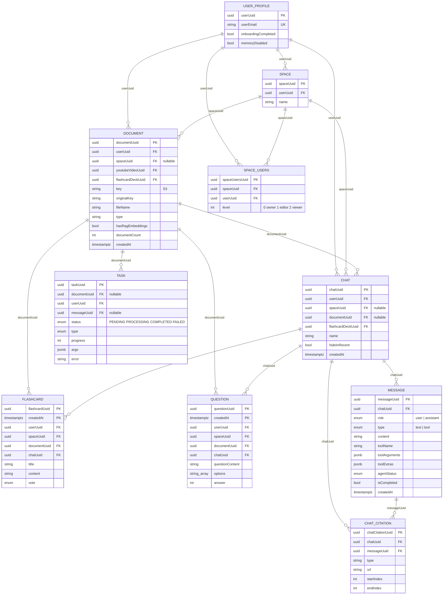

# 0003 — Database ERD (generated from `amplify/data/resource.ts`)

**Status:** Derived from code, not from the live database
**Date:** 2026-11-12

> Generated by reading `amplify/data/resource.ts`. No AWS connection was made.
> Renders in VS Code (Markdown preview, Mermaid extension) and on GitHub.

---

## A. Core content model (read this first)

Note `FLASHCARD` and `QUESTION` have **composite primary keys** `(uuid, createdAt)` — a Dynamo idiom. In Postgres the `createdAt` part becomes a plain indexed column, not a key.

---

## B. Everything (44 tables)

```mermaid
erDiagram
    SPACE ||--o{ DOCUMENT : ""
    SPACE ||--o{ CHAT : ""
    SPACE ||--o{ EXAM_PAPER : ""
    SPACE ||--o{ SPACE_USERS : ""
    SPACE ||--o{ FLASHCARD : ""
    SPACE ||--o{ QUESTION : ""
    SPACE ||--o{ FLASHCARD_GAME : ""
    SPACE ||--o{ MOCK_EXAM : ""

    DOCUMENT ||--o{ CHAT : ""
    DOCUMENT ||--o{ TASK : ""
    DOCUMENT ||--o{ DOCUMENT_SUMMARY : ""
    DOCUMENT ||--o{ DOCUMENT_SECTION : ""
    DOCUMENT ||--o{ DOCUMENT_VISION_OUTPUT : ""
    DOCUMENT ||--o{ EXTRACTED_QUESTION_PLACEHOLDER : "not a real edge"
    DOCUMENT ||--o{ EXAM_PAPER : ""
    DOCUMENT ||--o{ USER_REQUEST : ""
    DOCUMENT ||--o{ MEMORY_BLOCK : ""

    CHAT ||--o{ MESSAGE : ""
    CHAT ||--o{ CHAT_CITATION : ""
    CHAT ||--o{ QUIZ : "sourceUuid (polymorphic)"
    CHAT ||--o{ MEMORY_CANDIDATE : ""

    MESSAGE ||--o{ CHAT_CITATION : ""

    QUIZ ||--o{ QUIZ_QUESTION : ""
    QUIZ ||--o{ QUIZ_ATTEMPT : ""

    EXAM_PAPER ||--o{ EXAM_PAPER_QUESTION : ""

    MOCK_EXAM ||--o{ MOCK_EXAM_LOG : ""

    QUESTION_EXTRACT_JOB ||--o{ EXTRACTED_QUESTION : ""
    QUESTION_GENERATION_JOB ||--o{ EXTRACTED_QUESTION : ""
    EXAM_MODULE ||--o{ EXTRACTED_QUESTION : "examModuleUuid"

    FLASHCARD_DECK ||--o{ DOCUMENT : "referenced by"
    FLASHCARD_DECK ||--o{ CHAT : "referenced by"

    PARTNERSHIP ||--o{ FUTURE_USER : ""
    BUNDLE ||--o{ PURCHASE : ""
    RECEIPT ||--o{ PURCHASE : ""
    QUIZ ||--o{ EXTRACTED_QUESTION : "unrelated"

    USER_PROFILE {
        uuid userUuid PK
    }
    SPACE_USERS {
        uuid spaceUsersUuid PK
        uuid spaceUuid FK
        uuid userUuid FK
    }
    MOCK_DOCUMENT {
        uuid mockDocumentUuid PK
        uuid documentUuid FK
    }
    DATALAB_REQUEST {
        string requestId PK
        uuid documentUuid FK
        uuid taskUuid FK
        uuid userUuid FK
        string taskToken "step functions pause token"
        string status
    }
    METADATA {
        uuid metadataUuid PK
        string targetUuid "polymorphic"
        string targetType "polymorphic"
        string name
        string value
    }
    DOCUMENT_SUMMARY {
        uuid documentSummaryUuid PK
        uuid documentUuid FK
        enum status
        enum vote
    }
    DOCUMENT_SECTION {
        uuid documentSectionUuid PK
        uuid documentUuid FK
    }
    DOCUMENT_VISION_OUTPUT {
        uuid documentVisionOutputUuid PK
        uuid documentUuid FK
        int pageNumber
    }
    QUESTION_EXTRACT_JOB {
        uuid questionExtractJobUuid PK
        uuid userUuid FK
        string answerKeyStatus
        enum status
    }
    QUESTION_GENERATION_JOB {
        uuid questionGenerationJobUuid PK
        uuid userUuid FK
        enum status
    }
    EXTRACTED_QUESTION {
        uuid extractedQuestionUuid PK
        uuid questionExtractJobUuid FK
        uuid questionGenerationJobUuid FK
        uuid examModuleUuid FK
        enum questionType
        enum difficulty
        bool verified
    }
    MOCK_EXAM {
        uuid mockExamUuid PK
        uuid userUuid FK
        uuid spaceUuid FK
        uuid chatUuid FK
        enum creationStatus
    }
    MOCK_EXAM_LOG {
        uuid mockExamLogUuid PK
        uuid mockExamUuid FK
        int score
    }
    SAT_MINI_EXAM_LOG {
        uuid satMiniExamLogUuid PK
        uuid userUuid FK
        int predictedSATScore
    }
    QUIZ_QUESTION {
        uuid quizQuestionUuid PK
        uuid quizUuid FK
        uuid sourceUuid "polymorphic"
        uuid userUuid FK
    }
    QUIZ_ATTEMPT {
        uuid quizAttemptUuid PK
        uuid quizUuid FK
        uuid userUuid FK
        int score
    }
    FLASHCARD_GAME {
        uuid flashcardGameUuid PK
        uuid userUuid FK
        uuid spaceUuid FK
        int progress
    }
    YOUTUBE_VIDEO {
        uuid youtubeVideoUuid PK
        string videoId UK
        string transcriptKey
    }
    EXAM_PAPER_QUESTION {
        uuid examPaperQuestionUuid PK
        uuid examPaperUuid FK
        uuid moduleUuid
        enum difficultyLevel
    }
    APP_SETTINGS {
        uuid appSettingsUuid PK
        bool memoryFeatureEnabled
    }
    EXAM_MODULE {
        uuid examModuleUuid PK
        string moduleName
        int price
        bool retired
    }
    CURIO_SUBSCRIPTION {
        uuid subscriptionId PK
        uuid userId FK
        enum tier "super | ultra"
        enum status
        enum provider
    }
    RECEIPT {
        uuid receiptId PK
        uuid userId FK
        string payload
    }
    PURCHASE {
        uuid userId PK
        uuid bundleUuid PK
        uuid receiptId FK
        timestamptz revokedAt
    }
    FUTURE_USER {
        uuid futureUserUuid PK
        uuid partnershipUuid FK
        string email UK
        bool subscriptionGranted
    }
    USER_REQUEST {
        uuid userUuid PK
        timestamptz createdAt PK
        uuid documentUuid FK
        uuid youtubeVideoUuid FK
        string model
        int totalTokenCount
        enum category
    }
    USER_ACTION_LOG {
        uuid userActionLogUuid PK
        uuid userUuid FK
        uuid sourceUuid
        enum actionType
    }
    USER_LEARNING_PROFILE_HISTORY {
        uuid userLearningProfileHistoryUuid PK
        uuid userUuid FK
        string concept
    }
    MEMORY_BLOCK {
        uuid memoryBlockUuid PK
        uuid ownerUuid FK
        uuid documentUuid FK
        enum scope "user folder file system"
        float confidence
        int frequency
        int version
    }
    MEMORY_CANDIDATE {
        uuid memoryCandidateUuid PK
        uuid ownerUuid FK
        uuid chatUuid FK
        uuid messageUuid FK
        enum decision "created merged rejected"
    }
    BATCH_PROCESS {
        uuid processId PK
        string jobType
        enum state
        int totalJobs
        int completedJobs
    }
```

---

## C. Five things this picture tells you

1. **Three polymorphic links can't become foreign keys.** `Quiz.sourceUuid` + `sourceType` (document *or* chat), `QuizQuestion.sourceUuid`, `Metadata.targetUuid` + `targetType`. In Postgres: either two nullable FKs (`document_uuid`, `chat_uuid`) with a `CHECK` that exactly one is set, or keep them as plain columns without constraints.
2. **Ownership is repeated on purpose.** `userUuid` appears on ~25 tables. Keep it — it lets RLS work without joins.
3. **Nothing enforces these edges today.** Dynamo has no foreign keys, so any arrow above can already be dangling. Adding constraints will surface orphans.
4. **`Task` is the pipeline's state machine**, and `DatalabRequest.taskToken` is the Step Functions pause token — both survive a DB move; only the trigger changes (polling instead of streams).
5. **`UserRequest` is likely the biggest table** (one row per AI call, 28 columns). Plan a time window, not a full copy, if size becomes an issue.

*(The `EXTRACTED_QUESTION_PLACEHOLDER` and `QUIZ ||--o{ EXTRACTED_QUESTION : "unrelated"` edges in diagram B are artifacts of a hand-written diagram — no such relation exists in the schema. Removing them on the next pass.)*
